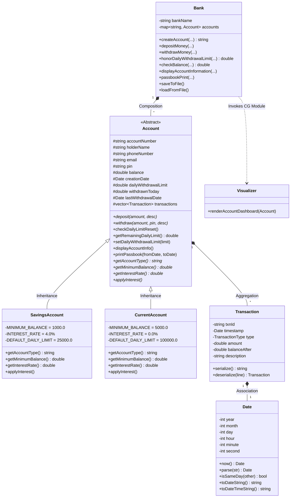

# 🏦 Apex Core Banking System (OOP & CG Mini-Project)

[](https://isocpp.org/)
[](https://www.python.org/)
[]()
[]()

> **Laboratory:** Object Oriented Programming & Computer Graphics (OOP & CG)  
> **Author:** [Vaishnavi Jare](https://github.com/vaishnavijare60-hash)  
> **Repository:** [vaishnavijare60-hash/OOP-CG-miniproject-](https://github.com/vaishnavijare60-hash/OOP-CG-miniproject-.git)

---

## 📌 Problem Statement

Design and develop an Object-Oriented **Banking System** featuring Computer Graphics analytics that supports the following operations:

* **a. Create an account** (Savings / Current with PIN protection and minimum initial balance)
* **b. Deposit money** (Credit funds with automated transaction journaling)
* **c. Withdraw money** (Debit funds subject to minimum balance and daily limit)
* **d. Honor daily withdrawal limit** (Track daily withdrawal amounts, reject limit breaches, reset per calendar day)
* **e. Check the balance** (Real-time balance inquiry, available funds, remaining daily allowance)
* **f. Display Account information** (Comprehensive customer card and account metrics)
* **g. Passbook Print (from to)** (Tabular passbook generation filtered by date range or transaction index with debit/credit ledger and summary totals)
* **★ Computer Graphics (CG) Visual Analytics Dashboard** (2D Bar Charts, Balance Curves, Vector Bank Icon, and Dynamic Limit Gauge)

---

## 🏗️ Object-Oriented Programming (OOP) Architecture



### Key OOP Principles Implemented

1. **Encapsulation & Data Hiding:**  
   Account balances, PINs, and transaction histories are strictly encapsulated with private/protected access modifiers and validated through secure getters, setters, and operation methods.
2. **Inheritance & Hierarchy:**  
   The abstract base class `Account` defines standard banking behavior, specialized into `SavingsAccount` (4.0% interest, ₹1,000 min balance, ₹25,000 daily limit) and `CurrentAccount` (business account, ₹5,000 min balance, ₹100,000 daily limit).
3. **Polymorphism & Dynamic Binding:**  
   Virtual functions (`getAccountType()`, `getMinimumBalance()`, `getInterestRate()`, `applyInterest()`) allow the `Bank` manager to treat accounts uniformly via base pointers (`std::shared_ptr<Account>`).
4. **Robust Exception Handling:**  
   Custom exception hierarchy inheriting from `std::exception`:
   * `DailyLimitExceededException` (reports limit, withdrawn today, remaining allowance, and attempted amount)
   * `InsufficientFundsException` (guards minimum balance requirement)
   * `AuthenticationException` (protects accounts against unauthorized PIN access)
   * `InvalidAmountException` (validates deposits/withdrawals > 0)
   * `AccountNotFoundException`
5. **Operator Overloading:**  
   Stream insertion `operator<<` overloaded for `Date`, `Transaction`, and `Account`.
6. **Persistence & Serialization:**  
   Full text file storage (`data/bank_data.txt`) preserving all customer records and transaction logs across sessions.

---

## 🎨 Computer Graphics (CG) Concepts Implemented

The Computer Graphics module provides rich 2D visual analytics:

* **Vector Icon Generation:** Procedurally draws a classical Greek pediment bank building using GDI/Canvas polygons, rectangles, and columns.
* **Coordinate Mapping & Transformations:** Maps financial amounts and dates to screen pixel coordinates with dynamic Y-axis scale rounding.
* **Transaction Bar Chart:** Renders Emerald Green positive bars for deposits and Crimson Red bars for withdrawals with labeled amounts.
* **Balance Trajectory Polyline:** Plots a connected line graph tracking balance changes across transactions with anti-aliased vertex markers.
* **Dynamic Daily Limit Gauge:** A progress bar with threshold color transitions:
  * 🟢 **Green (< 50% limit used):** Safe operating threshold.
  * 🟡 **Amber (50% – 85% limit used):** Caution zone.
  * 🔴 **Red (> 85% limit used):** Critical limit alert.
* **Double Buffering:** Implemented via Win32 GDI Memory Device Context (`CreateCompatibleDC`, `CreateCompatibleBitmap`, `BitBlt`) to completely eliminate screen flicker.

---

## 📂 Project Structure

```
OOP-CG-miniproject/
│
├── README.md               # Comprehensive project documentation
├── CMakeLists.txt          # CMake build file
├── Makefile                # Makefile for g++
├── build.bat               # One-click Windows build script
├── run.bat                 # One-click C++ execution script
├── run_python.bat          # One-click Python execution script (GUI & CLI)
├── banking_system.py       # Full Python implementation (Tkinter GUI + CLI)
├── .gitignore              # Git ignore rules
│
├── include/                # C++ Header Files
│   ├── Date.h              # Date/Time representation & comparison
│   ├── Transaction.h       # Transaction data model & serialization
│   ├── Exceptions.h        # Custom OOP exception classes
│   ├── Account.h           # Abstract base class Account
│   ├── SavingsAccount.h    # Derived class SavingsAccount
│   ├── CurrentAccount.h    # Derived class CurrentAccount
│   ├── Bank.h              # Central Bank manager & persistence
│   ├── Visualizer.h        # Win32 GDI Computer Graphics module
│   └── ConsoleUI.h         # Interactive terminal user interface
│
├── src/                    # C++ Implementation Files
│   ├── Date.cpp
│   ├── Transaction.cpp
│   ├── Account.cpp
│   ├── SavingsAccount.cpp
│   ├── CurrentAccount.cpp
│   ├── Bank.cpp
│   ├── Visualizer.cpp
│   ├── ConsoleUI.cpp
│   └── main.cpp
│
└── data/                   # Persistent storage
    ├── bank_data.txt       # Account and transaction data store
    └── sample_passbook.txt # Sample exported passbook statement
```

---

## 🚀 How to Build and Run

Both **C++** and **Python** implementations are included for maximum compatibility.

### Option 1: Running with Python (Recommended for Quick Demo & Modern GUI)

```bash
# 1. Run the Graphical User Interface (Tkinter + 2D Graphics Canvas)
python banking_system.py

# OR double-click:
run_python.bat

# 2. Run the Interactive Terminal Console (CLI Mode)
python banking_system.py --cli
```

### Option 2: Compiling & Running C++ (MinGW / GCC)

#### Method A: Using the one-click build script
```cmd
build.bat
run.bat
```

#### Method B: Manual g++ compilation
```bash
g++ -std=c++14 -O2 -Iinclude src/*.cpp -o banking_system.exe -lgdi32 -luser32
./banking_system.exe
```

#### Method C: Using Make
```bash
make
./banking_system.exe
```

---

## 📋 Operations Walkthrough

### a. Create an Account
Prompts for customer name, mobile number, email, account type (Savings / Current), 4-digit PIN, initial deposit, and optional custom daily limit.
* Validates minimum opening balance (₹1,000 for Savings, ₹5,000 for Current).
* Automatically allocates account numbers: `SB1001`, `SB1002`, `CA2001`, etc.

### b. Deposit Money
Credits amount to the account and generates an immutable ledger transaction with timestamp.

### c. Withdraw Money
Debits funds after validating:
1. Exact 4-digit PIN authentication.
2. Available balance does not violate the minimum balance threshold.
3. Daily withdrawal limit is not breached.

### d. Honor Daily Withdrawal Limit
* Tracks aggregate withdrawals conducted on the current calendar day.
* Automatically resets the daily accumulator when a new calendar day begins.
* If a withdrawal exceeds the daily allowance, it throws `DailyLimitExceededException` detailing:
  ```
  [TRANSACTION DECLINED] Daily Withdrawal Limit Exceeded!
    * Daily Limit Allowed : INR 20,000.00
    * Already Withdrawn   : INR 4,500.00
    * Remaining for Today : INR 15,500.00
    * Attempted Amount    : INR 16,000.00
  ```

### e. Check Balance
Displays current account balance, withdrawable balance (above minimum reserve), and today's remaining daily limit allowance.

### f. Display Account Information
Outputs customer card with phone, email, creation date, interest rate, current balance, and withdrawal limit metrics.

### g. Passbook Print (from to)
Generates an official passbook statement between two dates (`From Date` to `To Date`) or across transaction sequence numbers:

```
============================================================================================
                                OFFICIAL BANK PASSBOOK                                  
============================================================================================
Account Number : SB1001           Holder Name  : Vaishnavi Jare
Account Type   : SAVINGS          Filter Range : 2026-01-01 to 2026-12-31
Current Bal    : INR 28,000.00
--------------------------------------------------------------------------------------------
Date & Time         Txn ID     Type        Debit (INR)   Credit (INR)  Balance (INR)   Description
--------------------------------------------------------------------------------------------
2026-10-19 19:31:31 TXN1001    OPENING     -             25,000.00     25,000.00      Account Opening Initial Deposit
2026-10-19 19:31:31 TXN1002    DEPOSIT     -             5,000.00      30,000.00      Salary Credited
2026-10-19 19:31:31 TXN1003    DEPOSIT     -             2,500.00      32,500.00      Freelance Payment
2026-10-19 19:31:31 TXN1004    WITHDRAWAL  3,000.00      -             29,500.00      ATM Cash Withdrawal
2026-10-19 19:31:31 TXN1005    WITHDRAWAL  1,500.00      -             28,000.00      Grocery Store POS
--------------------------------------------------------------------------------------------
SUMMARY FOR PERIOD:
  * Total Transactions Recorded : 5
  * Total Amount Debited        : INR 4,500.00
  * Total Amount Credited       : INR 32,500.00
  * Net Transaction Difference  : INR 28,000.00
============================================================================================
```

Statements can also be exported directly to disk (`data/passbook_<account>.txt`).

---

## 📊 Pre-Loaded Sample Accounts

For convenience during demonstration and grading, two pre-configured accounts are provided:

| Account Number | Holder Name | Type | PIN | Current Balance | Daily Withdrawal Limit |
|:---:|:---:|:---:|:---:|:---:|:---:|
| `SB1001` | Vaishnavi Jare | Savings | `1234` | ₹28,000.00 | ₹20,000.00 |
| `CA2001` | Tech Innovations Corp | Current | `9999` | ₹85,000.00 | ₹50,000.00 |

---

## 📜 License

This mini-project is licensed under the [MIT License](LICENSE). Developed for academic excellence in Object-Oriented Programming and Computer Graphics.